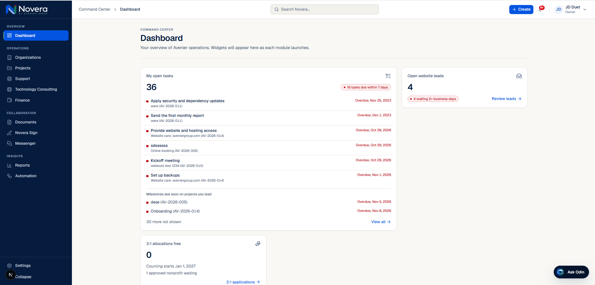
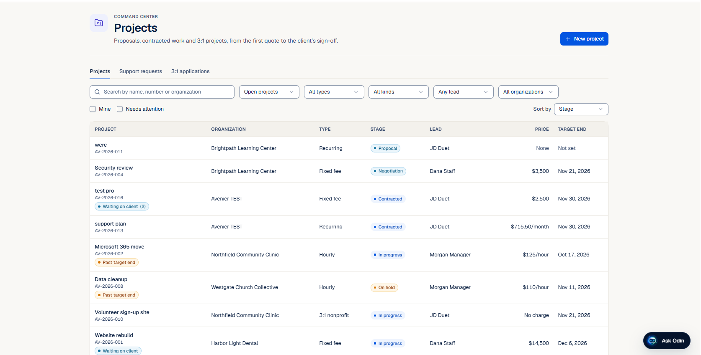
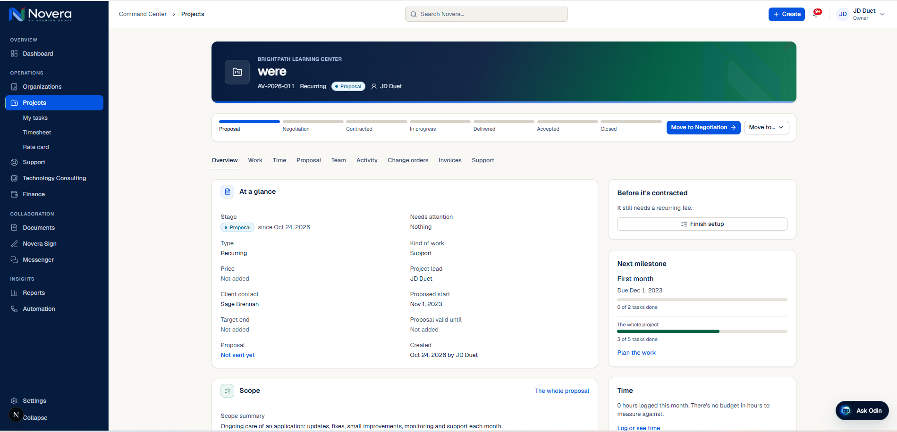
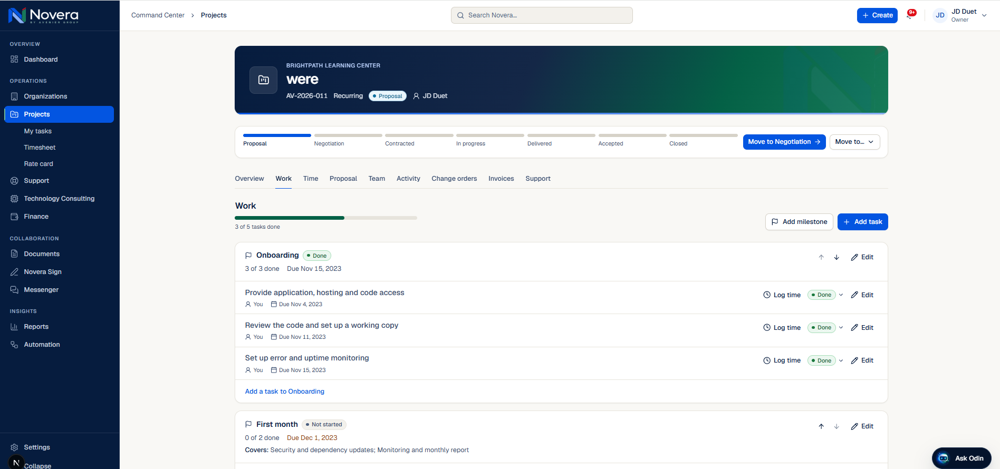
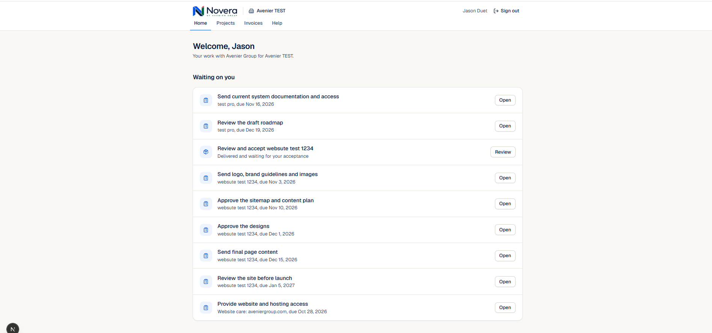
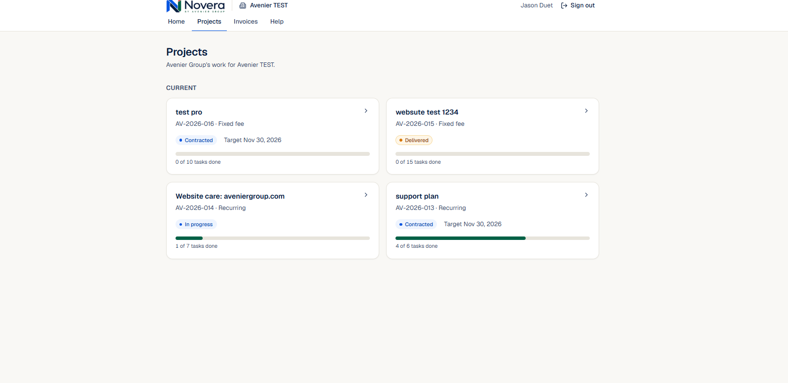
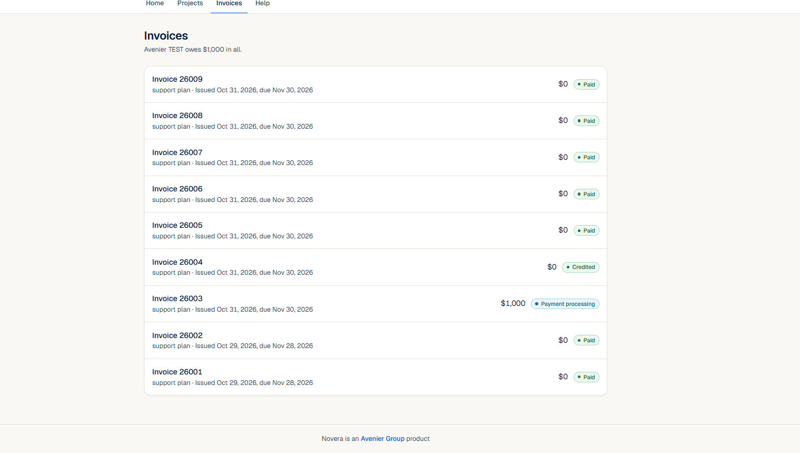

# Novera Application Walkthrough

> **Demonstration data:** Screenshots were captured from a local Novera environment using fictional/sample records. They illustrate the application's interface and visible workflows; they are not evidence of independent security certification or a passing production test suite. The private production source code is not included in this repository.

## 1. Staff Command Center

**Command Center dashboard.** Staff-facing navigation brings together operational modules such as organizations, projects, support, finance, documents, and reporting. The dashboard displays task and milestone summaries, website leads, and nonprofit program activity. Counts and dates shown are demonstration values.

## 2. Project Portfolio and Lifecycle

**Project portfolio.** The listing presents project names, organizations, engagement types, stages, leads, prices, and target dates. Search, filters, and sorting controls are visible. Their presence is shown; individual query implementations are not exposed here.

**Project overview.** A project detail page shows a lifecycle from Proposal through Closed, alongside contextual sections for work, time, proposals, team, activity, change orders, invoices, and support. The screen illustrates how multiple business processes are organized around a project record.

## 3. Work Execution

**Milestones and tasks.** The Work tab groups tasks under milestones and displays assignments, deadlines, completion status, progress, and available actions for adding or editing work and logging time. The screenshot documents the interface, not the result of executing each action.

## 4. Client Self-Service

**Client portal home.** A separate client-facing interface shows outstanding requests, reviews, and deadlines, with navigation for projects, invoices, and help. This is distinct from the staff Command Center.

**Client project portfolio.** Clients see project cards with contract types, stages, target dates, and task-completion progress. This illustrates a simplified presentation of project information for the client audience.

**Client invoices.** The billing screen displays an outstanding-balance summary, invoice identifiers, dates, amounts, and states such as Paid, Credited, and Payment processing. These are fictional demonstration records. The screenshot does not independently establish that an external payment was processed.

## Engineering Context

The screenshots are a visual complement to the technical documents:

- [Architecture and Technology Decisions](architecture-and-decisions.md)
- [Security Engineering and Testing](security-and-testing.md)
- [Engineering Challenges and Lessons Learned](engineering-challenges.md)
- [AI-Assisted Development Disclosure](ai-assisted-development.md)

The public repository also includes an illustrative, independently runnable TypeScript permissions example. It is **not** extracted from Novera's private production implementation.

## Presentation Notes

Some demonstration records retain rough placeholder titles or historical dates. They are not real customer records. The screenshots have not been altered to fabricate a polished interface; the client home image was cropped only to remove the operating-system taskbar. If new screenshots are captured with improved sample data, replace the images while keeping these descriptive filenames and checking the captions for accuracy.
